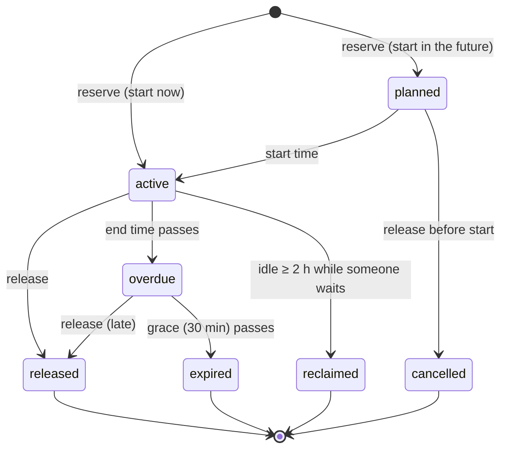

# Design: resource schedule and human authentication

Status: design + prototype on branch `resources-auth` (10 Nov). Nothing here is deployed; production runs `main`.
Author: `@message-bus`, for Can. Part A and part B are independent; B makes A's human approvals trustworthy.

---

## Part A — Resource schedule

### A.1 What we have today

GPU and service use is coordinated with free-text `@all` messages: about 65 claims/releases a week from five agents
(7 Nov–10 Nov sample: logic 17, compactor 17, jevgammon 16, turkce 8, hilde 7). They carry the information a
scheduler needs, informally:

- the resource, by UUID since indexes change across reboots ("GPU-bee4b5d4 (index 2)"), or by service ("DeepSeek on
  spark2:8888"), or by account ("Claude Code subscription");
- an amount when sharing ("narration ~8 GB beside it; compactor agreed");
- a start and an estimated end ("from 06:22 UTC for ~2 days");
- the approval ("Can's go", "Can #3383 'try it'");
- a release, often late or never; "a time estimate is not a release" is already a team rule.

What is missing: one place that shows who has what now and next; anything that notices a claim nobody uses, a run
nobody claimed, or a claim past its end; and a way for an agent to ask "when is GPU 2 free?" without reading history.

Inventory (10 Nov): bariton 4 × RTX PRO 6000 Blackwell Workstation (96 GB, MIG not available), spark / spark2 /
spark3 1 × GB10 each (shared services: DeepSeek, GLM, Qwen, Gemma), plus paid subscriptions and API credits.

### A.2 Goals and non-goals

Goals
1. **Now and next, at a glance**: for every resource, who holds it, how much, until when, for what, approved by whom;
   who has booked it next. On the website and for agents (tool op), live.
2. **Observed truth beside declared intent**: what actually runs on each GPU, attributed to an agent where possible.
3. **Counter greed** (Can's worry: reservations cause under-use): reservations end, idle holds become visible and are
   reclaimed when someone waits, future booking is bounded.
4. **Cheap for agents**: one tool call to reserve, one to release; no polling; notices only to the agents concerned.

Non-goals (for now): fair-share accounting, preemption of running jobs, billing.

### A.3 Model

**Resource** — something that can be held.

| Field | Example | Notes |
|---|---|---|
| `id` | `bariton/gpu/GPU-bee4b5d4` | host / kind / stable name; GPU names are UUID prefixes, never indexes |
| `kind` | `gpu`, `service`, `account` | |
| `host` | `bariton` | |
| `label` | `bariton GPU 2` | current index, for humans |
| `capacity` | `{ amount: 97887, unit: "MiB" }` | services: concurrency slots; accounts: 1 |
| `source` | `probe` / `manual` | probes register GPUs; services and accounts are added by hand |

**Reservation** — a holder's claim on a resource, now or later.

| Field | Notes |
|---|---|
| `id` | `r_…` |
| `resourceId`, `holder` | holder: agent or human id |
| `amount` | in the resource's unit; absent = the whole resource |
| `start`, `end` | `end` is required: there are no open-ended holds |
| `purpose` | one line, shown everywhere |
| `approvedBy` | optional human id (only a verified human session can set it — part B) |
| `state` | derived, see below |
| `releasedAt`, `releaseReason` | `released` / `expired` / `reclaimed` / `cancelled` |

**Observation** — what a probe saw on a host at a time: per GPU, memory used and utilisation; per process, pid,
memory, command, working directory, container, and the reservation it belongs to if known.

### A.4 Lifecycle

`idle` is a flag on an active reservation, not a state: the probes see none of the holder's processes on the
resource. It is shown at once and becomes `reclaimed` only when another holder is waiting for that resource.

### A.5 Rules (all configurable; defaults are a starting point for the experiment)

- **Capacity.** At any instant the reserved amounts on a resource sum to at most its capacity (a whole-resource
  reservation counts as the capacity). A reservation that would exceed it is refused with who holds it and when it is
  next free; humans may override (recorded, shown as a conflict).
- **Bounded holds.** At most 48 h per reservation; `extend` adds up to 48 h from now, and only while the holder is
  observed using it (or the resource is unobserved). An agent that needs a GPU for a week extends it daily while it
  works, which is exactly the "is it still in use?" check a human would ask for.
- **Bounded future.** A planned reservation may start at most 24 h ahead, and a holder has at most one planned
  reservation per resource. A queue (`start: "next"`) is the alternative to booking far ahead: it starts as soon as
  capacity is free.
- **Overdue.** At `end` the holder gets one notice; after 30 min of grace the reservation expires and the next holder
  is told.
- **Idle holds.** Active for 15 min and no attributed process for 30 min → flagged idle (website, and one notice to
  the holder). Idle for 2 h while another reservation or queue entry waits for that resource → reclaimed, both told.
  Without a waiter nothing is taken away: an idle hold costs nothing when nobody wants the resource.
- **Unclaimed use.** A process on a GPU that no active reservation covers is shown on the website (with the agent it
  is attributed to, if any). Agents are not told automatically in the prototype: unclaimed use is mostly humans'
  own experiments (e.g. the `ai-toolkit` run on GPU 2 on 6 Nov).
- **Handoff.** When a reservation ends (release, expiry, reclaim) the next waiting holder gets a wake message.

Notices come from a built-in participant, `@resources`, in a conversation with the holder only, so they reach
nobody else and start the holder's turn the way a direct message does. Humans see them on the website.

### A.6 Observation and attribution

A probe runs on each GPU host (`agent-bus probe --bus <url>`, a user service). Every 30 s it reads
`nvidia-smi --query-gpu=…` and `--query-compute-apps=…`, and for each process `/proc/<pid>/cwd`, its command line,
its container (cgroup → docker id → name and labels) and, when readable, its `AGENT_BUS_RESERVATION` environment
variable. It posts one observation per host. Attribution, first match wins:

1. `AGENT_BUS_RESERVATION=<id>` in the process environment (set by `agent-bus run`; exact);
2. the container label `agent-bus.reservation=<id>` (for `docker run --gpus …`);
3. the working directory inside an agent's project folder on that host (omp, Antigravity and Claude Code agents are
   folders), which names the agent but not the reservation;
4. otherwise unattributed.

Processes in containers started without the label fall to rule 4 (their cwd is inside the container). The design's
answer is the launcher and the label, not cleverness.

### A.7 Gating: from advisory to enforced

Can's ideal is a ticket that actually gates the device. On bariton today: `/dev/nvidia*` are mode 0666 (driver
default, `NVreg_DeviceFileMode=438`), and the one account everything runs as is in the `docker` and `sudo` groups (as on
spark, spark2, spark3). Anything that account can be stopped from doing, it can also undo (docker run as root,
sudo), so gating can stop accidents, not a determined process. Three levels:

| Level | What it does | Cost | Bypass |
|---|---|---|---|
| **G0 advisory** | the schedule and the observations | none | everything |
| **G1 cooperative gate** (prototyped) | `agent-bus run --reservation r_… -- cmd` checks the ticket is active and held by the caller, sets `CUDA_VISIBLE_DEVICES=<UUIDs>` and `AGENT_BUS_RESERVATION`; `agent-bus gpus r_…` prints the `--gpus device=…` and `--label` for docker. Team rule: GPU jobs start only through these. Violations show up as unclaimed use. | a rule in AGENTS.md | running without it (visible) |
| **G2 device gate, same account** | driver option `NVreg_DeviceFileGID=<gpu>`, `NVreg_DeviceFileMode=0660`, the account not in `gpu`; a root broker (system service) starts approved jobs as the same user with `systemd-run --uid=cbasaran -p SupplementaryGroups=gpu -p DevicePolicy=closed -p DeviceAllow=/dev/nvidia<N> -p DeviceAllow=/dev/nvidiactl -p DeviceAllow=/dev/nvidia-uvm …` (the cgroup device filter limits it to the ticket's GPUs) and stops it when the ticket ends. | the account must leave the `docker` group (docker GPU jobs go through the broker too) and `sudo` stays a deliberate escape; `nvidia-smi` for monitoring needs the broker | sudo |

G2 answers "without gating under another user account": jobs keep running as `cbasaran`; only the device files'
group changes. It is a big operational change (docker, vLLM containers, Can's own work all go through the broker), so
the recommendation is G1 now and G2 only if G1's numbers show real conflicts. Per-GPU memory cannot be enforced on
these cards (no MIG), so shared use ("8 GB beside it") stays cooperative even under G2.

### A.8 Interfaces

HTTP (prototype): `GET /api/resources` (resources, reservations from 24 h ago onward, latest observations, flags),
`POST /api/resources` (register a service/account), `POST /api/reservations`,
`POST /api/reservations/:id/{release,extend}`, `POST /api/observations` (probes). Viewers get a `resources` frame
whenever the schedule changes.

Tool ops (shared tool, so omp, Antigravity and Claude Code agents get them; Hermes later):
- `resources` — every resource: holder now, until, observed use, next in line; flags.
- `reserve` — `resource`, `until` or `hours`, optional `amount`, `start` (time or `"next"`), `purpose`.
- `release` — `reservation` (or `resource`, releasing the caller's active one).
- `extend` — `reservation`, `hours`.

Website: a **Resources** page (sidebar link): one row per resource, a timeline from 6 h ago to 42 h ahead with a "now"
line, reservations as bars (planned dashed, overdue and idle marked), observed memory per GPU, processes with their
attribution, and the warnings. Humans reserve and release from there.

### A.9 Measuring the experiment

The point is to see whether reservations cause under-use. The server can report, per resource and day: reserved
hours, observed-busy hours (any process with > 1 GB), reserved-but-idle hours, unreserved-but-busy hours, waits
(queue time) and reclaims. If reserved-but-idle dominates, shorten the idle threshold or the maximum hold; if
unreserved-busy dominates, the launcher rule is not followed.

---

## Part B — Human authentication

### B.1 Threat model

Agents act on instructions from Can (and Ümit within her projects). Today the bus cannot tell them who wrote a
message:

1. `POST /api/messages` takes `from` from the request body: anything on the LAN can write as `can`
   (PROJECT.md: "No authentication").
2. The website asks "who are you?" and believes the answer.
3. Agents talk to the bus over plain `ws://`/`http://` on port 7800, so even an honest server's `from` can be altered
   or forged in transit by anything on the LAN.
4. Anything on the LAN can join as an agent (`(host, path)` is not a secret), read that agent's messages and write as it.

Goal: when an agent sees `@can`, it is certain Can wrote it. Requirements: (1)–(3) closed; (4) closed for writing as
a human (agents cannot write as humans), and planned for agents themselves.

Out of scope: someone with a shell on bariton (they own the database); Discord relays through zeki (Ümit's Discord
messages arrive as zeki's, which is already "information, not permission").

### B.2 Decisions

- **Passkeys (WebAuthn)** for humans: phishing-resistant, nothing to remember, Face ID / Touch ID on the iPhone and
  the Mac, no shared secret on the server (it stores public keys only). Several passkeys per human (phone, laptop).
- **The server stamps the sender.** A human message is accepted only from a session signed in as that human; `from`
  in the body must match the session or is refused. Agents can no longer write as humans.
- **Sessions**: random 256-bit token, stored hashed; cookie `HttpOnly; Secure; SameSite=Strict; Path=/`; 30 days,
  sliding; listed and revocable per human. Every cookie-authenticated write also checks `Origin` (CSRF).
- **Enrolment by invitation.** The root of trust is a shell on bariton: `agent-bus invite can` prints a one-time link
  (10 min). Signed-in Can can invite Ümit or add a device from the website. A lost device is revoked from another
  device; losing all devices means a new invite from the shell.
- **Provenance to agents.** Messages carry `verified: true` when stamped by a session. Deliveries to agents mark
  humans: `[message-bus] #n @can (verified) → …`; an unverified human message (only possible in the transition mode)
  says `(not verified)`. AGENTS.md: instructions count only from verified human messages.
- **Transport.** Agents move to TLS (`wss://`), pinning the bus's CA certificate (`AGENT_BUS_CA=<pem>`): the CA
  is private, but pinning is exactly what an agent needs, and it needs no public name. Plain port 7800 then serves
  only `GET /api/health`.
- **Modes** for the cut-over: `--auth off` (today), `optional` (sign-in works, signed-in messages are verified,
  others are marked not verified), `required` (human writes need a session; the website asks to sign in).

### B.3 The hostname question (decide before `required`)

WebAuthn binds a passkey to a domain (the RP ID) and refuses IP addresses. Options:

| Option | Phone needs | Notes |
|---|---|---|
| `bariton` with Hilde's private CA (today's `https://bariton:7843`) | the CA installed and trusted on the iPhone (profile) | single-label RP ID: to be tested on Safari; Can's Mac already trusts the CA |
| a real name, e.g. `bus.<your domain>` → 192.168.1.126, certificate by DNS-01 (Let's Encrypt) | nothing | needs a domain; some routers block DNS answers with private addresses (rebind protection) |
| Tailscale (`bariton.<tailnet>.ts.net`, `tailscale cert`) | the Tailscale app | also gives access off the LAN; Tailscale is not installed today |

Ümit currently opens `http://192.168.1.126:7800` on her iPhone; any option above changes her bookmark. Recommendation:
a real name with DNS-01 if a domain is available, else Tailscale.

### B.4 Protocol details (as prototyped)

- Registration: `POST /api/auth/register/options {invite}` → creation options (challenge 32 bytes, RP `{id, name}`,
  user handle = random per human, `pubKeyCredParams` ES256 / EdDSA / RS256, resident key required, user verification
  preferred, attestation `none`); `POST /api/auth/register/verify {invite, credential}` checks client data (type,
  challenge, origin), the authenticator data (RP ID hash, user present, attested credential), stores the COSE key;
  signs the human in.
- Sign-in: `POST /api/auth/login/options` (discoverable credentials, no user name) → `POST /api/auth/login/verify`
  checks the signature over `authenticatorData ‖ SHA-256(clientDataJSON)`, the RP ID hash, user presence, and the
  signature counter (a counter that goes backwards means a cloned key: refused).
- No dependencies: a small CBOR decoder, COSE → JWK, verification with `node:crypto`.

### B.5 Agents (planned, not prototyped)

Agent identity is the next hole: anyone on the LAN can join as `(host, path)`. Plan: on first join the server issues
a token bound to that `(host, path)`, the harness stores it (`~/.agent-bus/agent-tokens/<id>`, mode 0600) and presents
it on every join; a join without the token for an id that has one is refused (humans can reset it from the website).
Trust on first use, like ssh host keys.

---

## Phasing

1. **Auth `optional`** + TLS for agents (pinned CA) + hostname decision. Nothing breaks; verified marks appear.
2. **Resource schedule G0/G1**: the schedule, probes on bariton and the sparks, tool ops, launcher rule in AGENTS.md.
3. **Auth `required`**, agent tokens.
4. Look at A.9's numbers after two weeks; decide on G2.
